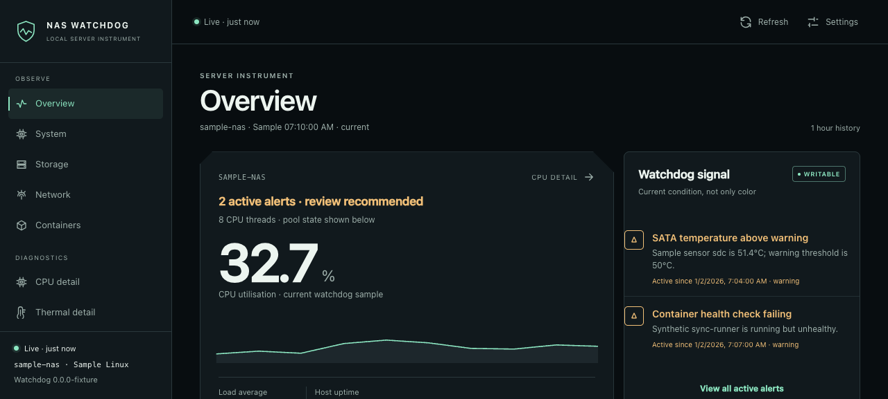

# NAS Watchdog

**Self-hosted monitoring for a NAS: storage health, component thermals, history, Docker inventory, and alerts.**

NAS Watchdog is an independent project for compatible Intel/AMD x86-64 Linux systems, primarily the Zettlab D6 Ultra and D8 Ultra running ZettOS. It reports a btrfs pool forced read-only, a hot NVMe controller, a stopped fan, an unhealthy disk, or a stopped container, and keeps enough history to show when it changed.

[Docker image](#quick-start) · [Android app](#android-app) · [Download APK](https://github.com/greyyk/nas-watchdog/releases/latest) · [Google Play closed test](https://forms.gle/7LxUcDdEPudx7pb3A) · [Documentation](#documentation)



The dashboard above is running on locally generated sample data. The Android app uses the same instrument-style design.

| | |
|---|---|
| **Supported platform** | Linux x86-64 (`linux/amd64`); D6 Ultra tested on ZettOS |
| **NAS diagnostics** | btrfs pools, RAID, SMART, per-device I/O, hwmon thermals, fans |
| **Delivered as** | Docker container with an embedded web UI; Android app |
| **Alerts** | ntfy, generic webhooks, dead-man's heartbeat, Android notifications |
| **Remote actions** | Opt-in and disabled by default |
| **License** | [MIT](LICENSE) |

## Features

- **Storage:** pool read/write state, btrfs corruption and allocation, scrubs, RAID, bcache, per-disk I/O, and full SMART attributes.
- **Thermals:** every temperature the kernel exposes, including per-core CPU readings, DIMMs, populated SATA/NVMe devices, board sensors, hardware limits, thermal trips, and fan RPM/PWM.
- **History:** 5-minute, 1-hour, 6-hour, and 24-hour charts with exact samples, minimum/average/maximum, change, and threshold exposure.
- **Docker:** discovers all containers, their health, resources, ports, and logs. Expected-container alerts are opt-in.
- **Alerts:** ntfy, generic webhooks, Android notifications, and an external heartbeat.
- **Actions:** Docker controls, btrfs scrub operations, and reboot recovery. All are opt-in and disabled by default.

No external metrics server, account, Firebase project, or chart service is required. The Go backend uses only the standard library and serves its UI directly from the container.

## Hardware support

| Model | Architecture | Status |
|---|---|---|
| **D6 Ultra (D6U)** | Intel Core Ultra 5 125H / x86-64 (`linux/amd64`) | Tested on a live ZettOS system |
| **D8 Ultra (D8U)** | Intel Core Ultra 5 125H / x86-64 (`linux/amd64`) | Expected compatible; hardware validation wanted |
| **D4 and D6** | RK3588 ARM | Not supported in this release |

Sensor availability depends on firmware and kernel support. The watchdog reports what the host exposes and never substitutes readings for missing GPU, UPS, PSU, IPMI, fan, or drive data.

Other x86-64 Linux distributions are usable with adaptation; see the [other-Linux notes](docs/OTHER_LINUX.md). Exact discovery behavior and the D8U validation checklist are in [Compatibility](docs/COMPATIBILITY.md).

## Android closed test

The Android app is in Google Play closed testing. To request access, [fill in the signup form](https://forms.gle/7LxUcDdEPudx7pb3A) with the Google account email you use on your Play-enabled device. If the form is unavailable, email <nas.closed.beta.numeric688@passmail.net>. Please don't include NAS addresses, tokens, logs, or serials.

Approved testers receive a Play tester link and must accept it with that same account before the app appears on Google Play. Signup is a request, not automatic enrollment; Play's country, account, and tester-count rules still apply. The signed GitHub APK needs no enrollment.

## Independence

NAS Watchdog is not affiliated with, sponsored by, authorized by, or endorsed by Zettlab or any other NAS manufacturer. Third-party names are used only to describe compatibility. See [Third-party names and independence](TRADEMARKS.md).

## Quick start

1. Enable SSH in ZettOS under **Settings → Security → SSH**, then connect with an administrator account.
2. Confirm Docker is available, the host is x86-64, and locate the btrfs pool.
3. Copy this repository to persistent storage, create `.env`, and set `WD_API_TOKEN` to a value from `openssl rand -hex 32`.
4. Run `sudo docker compose up -d --build`, then open `http://<nas-ip>:8090`.

```sh
uname -m                   # expected: x86_64
sudo docker compose version
findmnt -t btrfs -o TARGET,SOURCE,OPTIONS
```

Set `POOL_HOST_PATH` in `.env` if the pool is not mounted at the default `/zettos/pool/1`. The Compose file requires a non-empty API token; actions, automatic reboot, and expected-container alerts are off by default. Do not expose the HTTP service directly to the internet.

The [setup guide](docs/SETUP.md) covers verification, notifications, Android, updates, and troubleshooting. [Other-Linux notes](docs/OTHER_LINUX.md) explain what needs checking outside ZettOS.

## Hardware discovery

There are no fixed disk, NVMe, or fan counts:

- **SATA:** whole `sd*` block devices are discovered from `/sys/block`; every populated slot with a valid SMART temperature is included. Tests cover all eight SATA positions and non-disk exclusions.
- **NVMe:** controllers and channels follow the resolved hwmon sysfs path, not enumeration order.
- **CPU:** `coretemp` package/core labels map to physical core IDs and logical CPUs. Intel P/E topology is used when the kernel exposes it; otherwise the hottest core remains the CPU reading.
- **Memory, board, and cooling:** DIMM SPD sensors, other hwmon chips, thermal zones, fans, and PWM channels appear when available. A stopped fan remains visible at 0 RPM; an absent device creates no placeholder.
- **Docker:** inventory is read from the Docker API on every collection. `WD_EXPECTED_CONTAINERS` alerts only for containers you nominate.

Unsupported or hidden readings appear as **not reported**, never as manufactured zeros. Details are in [Compatibility](docs/COMPATIBILITY.md).

## Android app

The Android client includes live telemetry, last-good offline snapshots, CPU and thermal instruments, storage/SMART details, Docker controls and logs, network information, alert history, and guarded actions.

Each release publishes a signed APK, a Play-compatible AAB, and SHA-256 checksums through the [Release workflow](.github/workflows/release.yml). The direct APK keeps its existing signing identity; Play uses a separate upload key and Play App Signing. See [release installation](docs/RELEASING.md) and the [Google Play guide](docs/PLAY_STORE.md).

### Building from source

With JDK 17 and the Android SDK:

```sh
cd android
./gradlew assembleDebug
adb install -r app/build/outputs/apk/debug/app-debug.apk
```

In **Settings**, enter `http://<nas-ip>:8090` and the same API token. Enable notifications and live monitoring for the reconnecting alert stream; battery-saver checks run approximately every 15 minutes as a fallback. Android and device-vendor battery policies can delay background work. Force-stopping the app stops background checks until it is opened again.

## Alerting

- **ntfy:** private/self-hosted or public broker, with optional bearer authentication. Use an unguessable topic on a shared server.
- **Webhook:** JSON events with kind, ID, severity, title, detail, and onset time.
- **Heartbeat:** periodic HTTP GET for Healthchecks.io, Uptime Kuma, or another push monitor. Put the monitor off the NAS so a total NAS failure still alerts you.
- **Android:** reconnecting server-sent events plus periodic WorkManager checks. No push-service account is needed.

Temperature alerts are grouped per CPU and per NVMe controller to prevent one hot device from generating a notification for every sensor channel. Resolved events are reported separately.

## Security and permissions

This is a privileged host agent. Understand the trust boundary before deploying it:

- The host and pool are mounted read-only at `/host` and `/pool`.
- `privileged: true` is needed for raw-device SMART access; `pid: host` gives accurate host mount and namespace information.
- The Docker socket can control every container. Mutating API calls also require `WD_ALLOW_ACTIONS=true`, but a compromised container process could use the socket directly.
- Remote actions require the feature flag and request confirmation. Automatic reboot adds delay, cooldown, and reboot-loop suppression.

Use a long random token, keep `.env` private, review updates, and stay behind a trusted LAN or VPN. See [Security and remote actions](docs/SETUP.md#security-and-remote-actions) and the [security policy](SECURITY.md).

## Operations notes

- History is stored **in memory** and restarts with the container. Up to 2,880 samples provide 24 hours at the default 30-second interval; changing the interval changes that time span.
- SMART is polled every 10 minutes by default. Other samples are normally collected every 30 seconds.
- The event buffer holds the latest 200 events; alert state and selected reboot/counter state persist in the Docker volume.
- After an update, use the same project directory so Compose retains the `watchdog-data` volume.

### Published containers

The release workflow publishes Linux x86-64 (`linux/amd64`) images to **GitHub Container Registry**:

```text
ghcr.io/greyyk/nas-watchdog:<version>
ghcr.io/greyyk/nas-watchdog:latest
```

To use a pinned release instead of a local build, set `WATCHDOG_IMAGE=ghcr.io/greyyk/nas-watchdog:1.5.1` in `watchdog/.env`, then run `sudo docker compose pull` and `sudo docker compose up -d --no-build`. See [Release installation](docs/RELEASING.md#5-use-the-ghcr-image-on-zettos) for verification, upgrades, and package visibility.

## Documentation

- [Setup](docs/SETUP.md): ZettOS installation, Android, updates, troubleshooting
- [Configuration](docs/CONFIGURATION.md): environment variables and thresholds
- [Compatibility](docs/COMPATIBILITY.md): discovery behavior and the D8U checklist
- [Other Linux systems](docs/OTHER_LINUX.md)
- [HTTP API](docs/API.md)
- [Google Play guide](docs/PLAY_STORE.md)
- [Releasing](docs/RELEASING.md) and [testing notes](docs/TESTING.md)
- [Privacy](PRIVACY.md), [security](SECURITY.md), and [third-party notices](TRADEMARKS.md)
- [Contributing](CONTRIBUTING.md)

## Development and verification

```sh
# Go collector and API
cd watchdog
go test -race ./...
go vet ./...

# Android JVM tests, lint, and debug APK
cd ../android
./gradlew testDebugUnitTest lintDebug assembleDebug
```

The committed web CSS and vendored uPlot assets mean the Docker build does not need Node. To regenerate the UI CSS instead:

```sh
cd watchdog
npm ci
npm run build
```

GitHub Actions runs the Go tests, race detector and vet, Android tests/lint/APK build, Compose validation, and an x86-64 Docker image build. See [Continuous integration](.github/workflows/ci.yml).

The watchdog has been tested against a live D6U. Android UI testing has run on emulators; physical-device reports are welcome. See [Testing](docs/TESTING.md) for current evidence.

## Contributing

D8U validation, missing-sensor reports, Android device testing, and documentation fixes are especially useful. ARM support needs someone with D4/D6 hardware; a different build target alone is not support.

Use a small, redacted **[hardware report](docs/COMPATIBILITY.md#reporting-a-hardware-difference)** when opening a compatibility issue. Never upload `.env`, API tokens, ntfy topics/tokens, serial numbers, private IP addresses, raw logs, or a complete `/stats` response.

## License

NAS Watchdog is available under the **[MIT License](LICENSE)**. Bundled third-party assets retain their own licenses; see [THIRD_PARTY_NOTICES.md](THIRD_PARTY_NOTICES.md).
